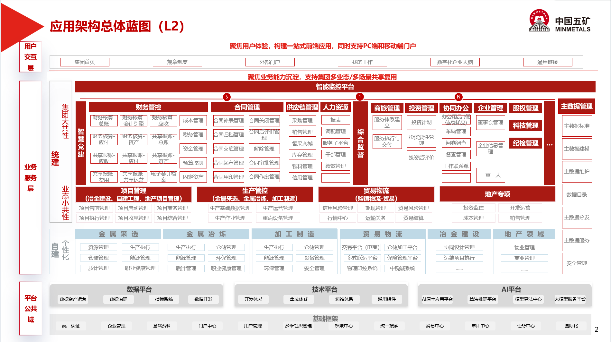
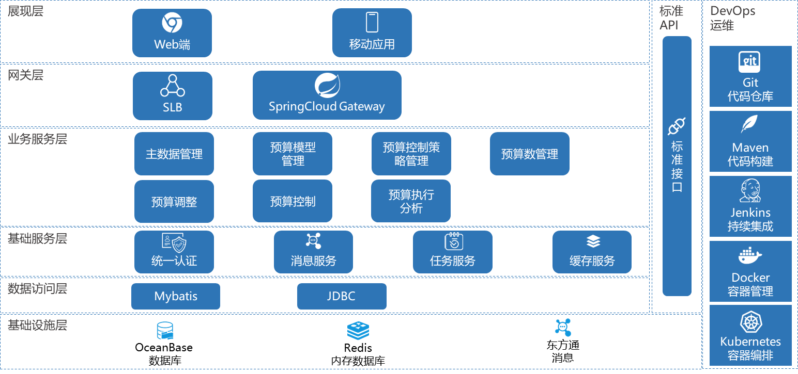

# 01 平台全景与建设范围

## 一、这是什么项目

**五矿集团统建系统建设项目—财务管控平台**：全集团统一、国产化的财务管控平台。

| 维度 | 内容 |
|---|---|
| 定位 | 落实国资委**穿透式监管**要求，构建「上下贯通、实时在线、自动预警」的智能化穿透式监管体系 |
| 目标 | **标准统一、流程协同、数据贯通、管控有效** |
| 手段 | 推动全集团财务管控系统**大集中**，以「财务一体化」支撑「业务一体化」 |
| 业务总纲 | 打通**核算报告、成本管会、资金管理、预算控制、投资资产、商旅费用**六大业财闭环 |
| 应用分组 | 财务核算应用组 / 财务管理应用组 / 财务报账应用组 |

下属单位解决方案里给了四条落地原则，看项目文档时可以拿来对照：

1. **集团统建优先** —— 最大化复用标准功能，本地化以配置为主，不轻易改代码；
2. **业财一体贯通** —— 业务单据驱动财务凭证，账实相符、业财一致；
3. **数据标准统一** —— 物料、客商、科目、组织等主数据同源；
4. **安全合规可控** —— 等保 2.0、信创、细粒度权限与审计日志。

上图是集团级应用蓝图：财务管控只是「集团大共性」里的一个域，右边与合同、供应链、商旅、投资、协同办公等域横向打通，下方由数据平台、技术平台、AI 平台和基础框架（统一认证、权限中心、消息中心等）托底。**记住这张图的位置关系，比记住几十个模块名有用得多。**

## 二、技术架构分层

技术架构在详细设计文档中统一按六层组织：

| 层 | 内容 |
|---|---|
| 展现层 | Web 端、移动应用（Vue3 + Pinia + Axios + Element-Plus + 五矿前端组件） |
| 网关层 | SLB、SpringCloud Gateway |
| 业务服务层 | 主数据、预算模型、控制策略、预算执行分析等业务服务 |
| 基础服务层 | 认证、消息、任务、缓存、工作流、规则引擎、接口集成 |
| 数据访问层 | Mybatis、JDBC |
| 基础设施层 | OceanBase、Redis、东方通消息；信创环境 |

DevOps 链路：`Git → Maven → Jenkins → Docker → Kubernetes`，部署由**波塞冬 Poseidon** 平台承载。

> ⚠️ 上图取自《预算控制》模块的 L3 详细设计文档，属**模块级**技术架构表达。平台级「技术平台应用架构蓝图」在知识库中只检索到汇报材料的目录条目，正文未取到 —— 如果需要向平台架构组确认统一技术总纲，指这个缺口。

平台公共能力由基础服务统一提供，业务应用**不重复建设**：SSO、权限服务、用户/账号/组织服务、工作流管理、任务调度、规则引擎、接口集成。

## 三、环境矩阵（最容易搞混的部分）

| 环境 | 门户地址 | 用途 |
|---|---|---|
| DEV 开发 | https://dsep-portal-dev.minmetals.com.cn | 开发自测 |
| TEST 测试 | https://dsep-portal-test.minmetals.com.cn（登录页 `/portal/signin`，用「4a 账号」） | 系统测试、集成测试、回归 |
| IMPL 实施定制 | https://dsep-portal-impl.minmetals.com.cn | 按客户需求做配置、扩展、迁移准备 |
| DEMO（UAT） | https://dsep-portal-demo.minmetals.com.cn | 财务关键用户验收 |
| STG 准生产 | https://dsep-portal-stg.minmetals.com.cn | 性能测试 |
| NEW-STG 新准生产 | https://dsep-portal-new-stg.minmetals.com.cn | 上线前最终验证 |
| PROTO 实施基线 | https://dsep-portal-proto.minmetals.com.cn | 实施基线环境 |
| PROD 生产 | https://portal.minmetals.com.cn | 生产 |
| DevOps | https://poseidon.minmetals.com.cn（需切到对应环境） | 部署与运维 |

纪律三条：

- **不要把 UAT 当联调环境**，UAT 是给财务关键用户验收的；
- 测试环境统一用 **4a 账号**登录；
- **生产不得手工发布**，必须走 Poseidon 流水线。

> ⚠️ PROTO（实施基线）与 IMPL（实施定制）的职责边界在文档中表述接近，以项目环境管理表为准。

## 四、部署形态与门户接入

1. **统一门户是唯一入口**：所有环境都是「五矿个人门户 + 环境后缀」，应用不对外暴露独立域名。
2. **容器化 + 平台化发布**：Poseidon 配置部署 YAML、探针；Docker/K8s 承载容器编排。
3. **前端走 nginx 网关**：静态资源 + nginx 反向代理接入，与后端服务解耦（部署说明书里有专门的「前端配置—nginx-gateway.conf」章节）。
4. **门户侧四类注册**（缺一个就出问题）：
   - 能力中心 → **应用管理**（应用编号、名称、负责人、服务地址）
   - 统一集成平台 → **API 注册管理**
   - 应用管理 → **编号管理中心**
   - 能力中心 → **消息中心 / 文件中心**
5. **数据访问按环境分租户**：开发库是 UAT 复制库、集中在 `data_migration` 租户，一个账号可访问全部 L2 业务库；正式环境各业务库分布在不同租户（约 10 个），需逐租户开账号。示例实例：开发 `10.202.160.141:9100`，正式 `10.202.160.141:9000`。

## 五、前端开发必须先知道的平台约束

| # | 约束 | 说明 |
|---|---|---|
| 1 | **技术栈基线** | Node 20.x、Vue 3.5.18、TS 5.x 为硬性基线；Vite 6.x、Vitest、ESLint 9.10.0、Scss（可选 UnoCSS）、Pinia 3.0.3 |
| 2 | **微前端方案存在口径冲突** | 多数 L3 文档写 **QianKun**；共享运营、应付核算文档写 **wujie 1.x（标注「暂定」）**。接入前必须与平台架构组确认最终主应用方案 |
| 3 | **不要自建登录/权限/组织体系** | 认证、权限、用户、组织、工作流、规则引擎全部由平台基础服务提供，业务前端通过 SSO 与平台权限模型取身份和菜单 |
| 4 | **先注册、再联调** | 应用要在门户能力中心注册，接口要在统一集成平台注册；同时接入编号中心/消息中心/文件中心，否则编码、消息、附件能力直接缺失 |
| 5 | **环境纪律** | 见上一节；生产发布只能走流水线 |
| 6 | **历史文档有技术栈代差** | 个别模块（如预算控制_控制引擎）L3 文档仍是 Vue Router 3.0.3 / Vuex / Vue CLI / Webpack 4 / Vant，属 Vue2 遗留口径，**不能当新工程脚手架参考** |

## 六、本篇的证据缺口

- 未取到「平台级统一技术架构总纲」正文，六层架构来自模块级 L3 文档 + 共享运营应用架构图。
- UI 组件库清单、编码规范/分支模型、包管理与脚手架模板、门户菜单权限模型细则**未检索到明确条款**，需向平台架构组索取《平台前端接入规范》。
- 建议向平台管理员索取两样东西：**Poseidon 应用清单**（核对工程名/负责人）与**门户能力中心注册目录**（核对 API 与编号中心接入状态）。