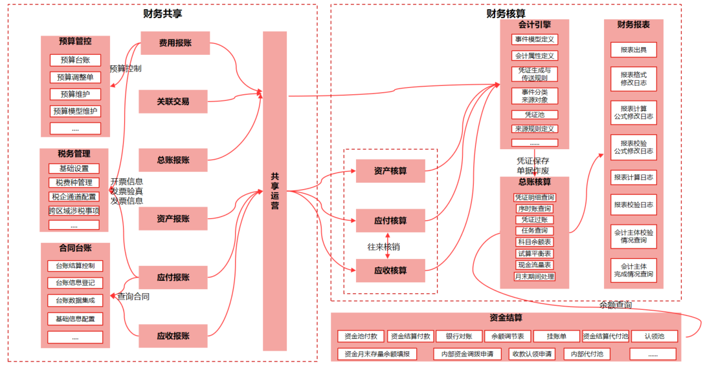
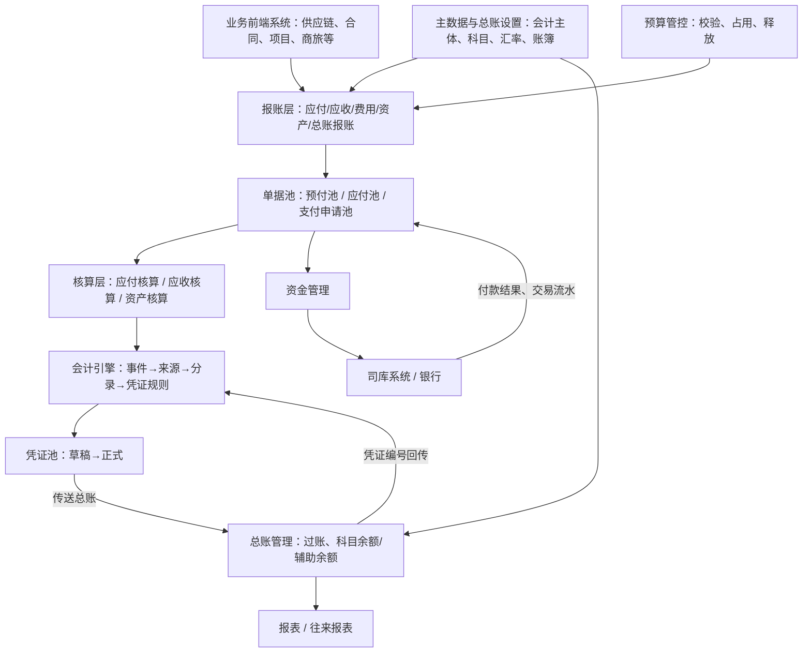
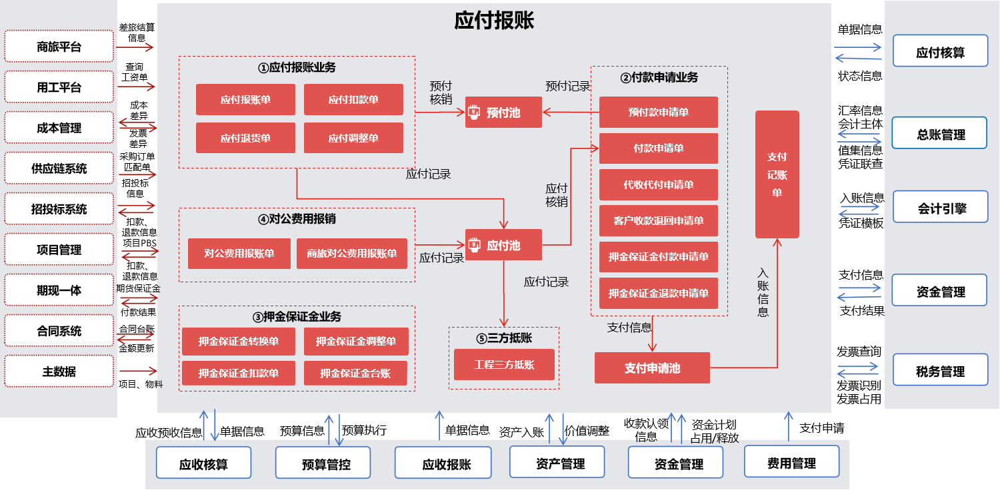

# 03 业务数据流与系统定位

> 这一篇回答新人最痛的问题：**几十个模块，数据到底怎么流？**

## 一、先建立框架：财务管控域拆成「四层」

看起来杂乱，其实所有模块都落在这四层上，每层只做一件事：

| 层级 | 干什么 | 典型模块 | 判断标准（开发视角） |
|---|---|---|---|
| **① 业务/报账层** | 把「发生的事情」变成**内部可审批的单据** | 费用报账、应付报账、应收报账、资产报账、总账报账、关联交易 | 有「报账单」页面、有审批流、有附件影像 |
| **② 处理/池层** | 单据暂存、核销、配对、待付 | 预付池、应付池、支付申请池、凭证池、共享运营派工 | 有「池 / 批次 / 认领」概念，状态会长期停留 |
| **③ 核算层** | 单据变成账（凭证 → 余额） | 应付核算、应收核算、资产核算、会计引擎、总账管理 | 有会计主体 / 账簿 / 期间 / 科目字段 |
| **④ 报告与资金层** | 出报表、真金白银收付 | 报表、往来报表、资金管理/资金池、资金结算、司库 | 对接银行、有交易流水 |

系统骨架是：**财务共享 → 共享运营 → 财务核算 → 资金结算 → 财务报表**。报账在最前发起，会计引擎/核算/总账在中间做账，资金结算和报表在最后收口。

左侧各类报账（费用/应付/应收/资产/总账/关联交易）+ 预算、税务、合同台账；中间共享运营做派工；右上财务核算（会计引擎、三套核算、总账核算）；右下资金结算；最右报表出具。

## 二、五条主线（只需要记住这五条）

### 主线 1：单据流（业务 → 报账 → 池）

前端业务系统（供应链、合同、项目、商旅、招投标、期现）把采购订单匹配单、合同台账、差旅结算、扣退款等信息推给**应付报账**；报账侧生成应付报账单/付款申请单/押金保证金单，进入**预付池、应付池**核销与记录，最终汇聚到**支付申请池**生成支付记账单。应收侧同理：收款认领 → 各类应收报账单（暂估收入、通用销售、工程对上计价）→ 开票申请。

> **开发要抓的点**：一条业务事实在系统里可能同时存在「外部单据、报账单、池记录、结算单」四份数据，通过单据编号与业务键关联，而不是一张表走到底。

### 主线 2：凭证流（报账单 → 会计引擎 → 凭证池 → 总账）

整个项目最关键、也最容易出错的链路：

1. 应收/应付/资产/费用报账等子模块的业务单据，**通过会计引擎生成凭证**；
2. 凭证先落**凭证池**：单据生成会计事件时即向凭证池写记录（支持同步调用，也支持消息队列异步写入）；
3. 凭证池内做**草稿(D) → 正式(F)** 状态转正，再「传送总账」；
4. **凭证池传输到总账**，总账过账后生成凭证编号，并**把凭证编号回传**到会计引擎的凭证上。

完整状态机：子模块单据生成会计事件 → 初始化凭证池记录 → 创建凭证（草稿/正式）→ 传送总账 → 过账 → 需要时冲销生成新凭证，全程带成功/失败校验与重试。

接口层面（`generate-formal`）的必填项很能说明边界：模块编码、会计主体编码、业务单据类型编码、会计日期、**流程方向（F 正向 / R 逆向）**、**是否传总账（Y/N）**；逆向时还必须填被冲销单据三件套。

> 会计引擎的设计定位值得前端记住一句：**业务数据不变，规则独立配置迭代**。所以「科目映射 / 辅助核算映射 / 校验规则」大多是配置项，不是写死的逻辑。

### 主线 3：主数据与基础设置流（谁在记账、按什么规则记）

- 币种、客商、合同、项目、银行账户、物料从**基础资料**同步获取，全模块共用一套；
- 反过来，**科目表、会计科目、汇率以总账为核心管控端**，先同步至基础资料，再由基础资料下发各模块；
- 法人、会计主体由**组织管理**统一搭建，总账通过集成获取主数据。

一句话记法：**「身份类」主数据往外发，「规则类」配置从总账往外发。**

### 主线 4：资金流（要付钱的那条线）

业务报账（费用/应付/应收/关联交易）提交对公付款/对私报销申请 → **资金计划校验** → 进入**资金管理**（账户管理、流水清分、资金池、票据、付款管理、资金计划）→ 与**司库系统**交互做银行转账、票据开立/背书/签收、账户开销变 → 结果回流（付款结果、票据信息、交易流水、账户余额/明细）回到报账与核算侧。合同台账提供合同与台账结算控制，预算管控提供额度校验。

> 关键是**结果回流**：付款失败、部分支付、票据背书被拒，都会改变报账单据与池的状态 —— 前端不能只在提交时联动。

### 主线 5：报表流（注意：它和凭证流不是一条路）

- **核算出数**：总账把账簿、会计主体、期间、科目余额/辅助余额提供给报表管理，报表系统直接从总账取数，做到「数据同源」；
- **管理报表出数**：往来报表管理**不走凭证流**，走**数据中台**：①源系统取数 → ②中间层数据处理 → ③标准化报表生成 → ④手工数据调整 → ⑤融合数据校验 → ⑥报送审批 → ⑦输出查询。

判断口径：**「核算类」看会计引擎和凭证，「报表/分析类」看数据中台和取数规则。**

### 主线汇总（依据上述证据整理，非原图）

## 三、叠一张「实管道图」：以应付报账为例

这张图几乎覆盖所有典型要素：左侧外部业务系统（商旅、用工、成本管理、供应链、招投标、项目管理、期现一体、合同系统、主数据）；中部五类报账业务与三个池（预付池、应付池、支付申请池），输出支付记账单；右侧对接应付核算、总账管理、会计引擎、资金管理、税务管理；底部与应收核算、预算管控、应收报账、资产管理、费用管理双向交互。

**看懂这一张，其它报账模块（费用、应收、资产、总账报账）都是同一套骨架的变体。**

### 读图技巧

这类产品图的图例有语义：**本功能 / 财务管控域内数据交互 / 跨财务管控域（跨域）数据交互 / 第三方系统集成**，箭头颜色和线型不同。同一张图里「域内」和「跨域」的接口，改造工作量完全不同 —— 先看图例再评估工作量。

## 四、各系统定位速查

| 系统 / 模块 | 一句话定位 | 上游给什么 | 下游拿什么 |
|---|---|---|---|
| 主数据 / 基础资料 | 全域「身份字典」 | 组织、客商、合同、项目、银行账户、物料 | 全模块共用 |
| 总账设置 | 「坐标系 + 规则」 | 科目表、会计科目、币种/汇率、账簿、会计日历、辅助核算规则、凭证模板 | 核算、报账、资金按它建账 |
| 报账层（费用/应付/应收/资产/总账报账） | 业务转财务的「入口」 | 外部单据、发票、合同 | 池、核算、会计引擎 |
| 报账池 / 支付申请池 | 未结清债权的「台账」 | 报账单、核销 | 付款申请、核算 |
| 核算层（应付/应收/资产核算） | 单据记账的末端 | 报账单数据、单据状态 | 会计引擎、总账 |
| 会计引擎 + 凭证池 | 「翻译官」+ 凭证暂存站 | 业务事件、来源规则 | 总账 |
| 总账管理 | 账的主库（凭证、余额、期间） | 凭证池推送 | 报表、对账 |
| 资金管理 / 结算 | 「钱」的出口 | 支付申请、资金计划 | 银行/司库、报账状态回写 |
| 预算管控 | 提交即校验的「闸门」 | 预算模型、控制策略 | 各业务系统的额度占用 |
| 报表 / 往来报表 | 出数与报送 | 总账余额、数据中台 | 监管报送、管理分析 |

## 五、一句话总结本篇

**业务事实 → 报账单 → 池 → 核算 → 凭证 → 总账 → 报表；钱则走「支付申请池 → 资金管理 → 司库 → 结果回流」。** 两条链路在「凭证池 / 支付记账单」处交汇，任何设计讨论都先问一句「这事属于哪条链路」。