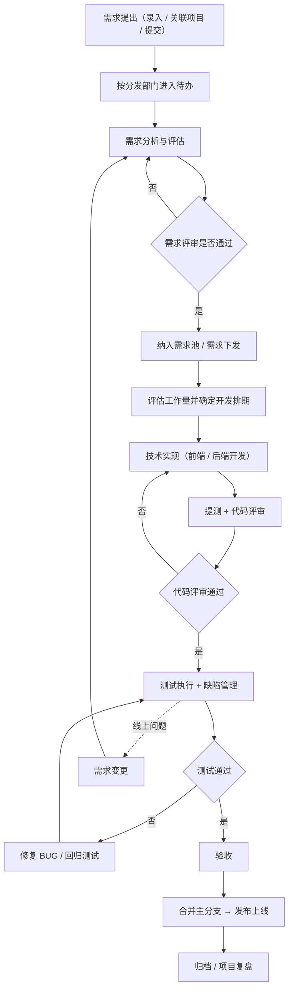

# 04 人员与组织分工

> ⚠️ 先说结论：**知识库里没有一份正式的项目组织架构 / 人员通讯录 / RACI 表**。下面把「文档能证明的」「能间接推断的」「完全查不到的」分开列，宁可空着也不编人名。

## 1 有据可查：3A 架构表的「负责人」

《3A架构表-应用架构L1-L5》只有 **「总账 & 关联交易」这一系列（V2.1、V1.0）带「负责人」列**，其余分册用的是「PRD / 技术设计 / 开发进度 / 功能测试结果 / 未关闭缺陷数」进度列，填的是产品经理、开发、测试角色，没有负责人列。

所以能落地的负责人只有这一段应用链：

| 应用组（L2） | 应用（L3） | 应用模块（L4）范围 | 负责人 |
|---|---|---|---|
| 财务核算-总账 | 总账设置 | 币种、汇率、单据序列号分配、导入模板管理、辅助核算规则、会计科目、科目表、凭证编码/打印/审批/自动冲销/自动过账规则、凭证来源、凭证类别、会计日历、期间映射、业务日历、账簿、账簿集、段值、值集、法人、管理单元、管理口径、会计主体 | **刘福** |
| 财务核算-总账 | 总账管理 | 凭证管理、经常性凭证、辅助明细余额表、辅助余额表、科目明细余额表、科目余额表、凭证明细查询、试算平衡表、现金流量表、序时账查询、报告币折算、外币重估、账簿折算 | **刘福** |
| 财务核算-总账 | 结账管理 | 关账工作台、结账任务管理、年结处理、期间管理 | **刘福** |
| 财务核算-总账 | 报表管理 | 报表自定义管理（定义、计算、校验、封存、完成、审核、打印、数据删除、手工结转、查询、编辑、穿透、日志） | **葛琦** |
| 共享报账-总账 | 总账报账 | 财务综合工单、业务类型、总账凭证报账单、总账业务报账单、报账明细汇总表、单据汇总表 | **马玉松** |
| 共享报账-总账 | 关联交易 | 关联方管理（主数据申请单查询/新增/编辑/查看、主数据查询、关联方详细定义、主数据变更查询） | **高玉磊** |

**按人汇总：**

- **刘福** —— 总账基础配置 + 总账业务查询 + 结账管理（V1.0 版另含科目管理、组织管理）
- **葛琦** —— 报表管理 / 资产负债表等具体报表
- **马玉松** —— 总账报账整条应用
- **高玉磊** —— 关联交易 / 关联方管理

### 应用级负责人（门户能力中心登记口径）

| 应用 | 应用编号 | 应用负责人 |
|---|---|---|
| 应收报账 | `app-minmetals-fm-fis-ar` | **赵伟** |
| 应付报账 | `app-minmetals-fm-fis-ap` | **王帅** |

> 注意：这是**应用级**负责人（按后端 `app-` 编号登记），文档没有单列「前端负责人」。同一应用的 `fe-` 工程与后端共用业务归属是合理推断，不是文档明示。
> Poseidon 部署页上出现的姓名（如「田蜜」「乔海平」）是**操作人**，不能当负责人证据。

### 测试阶段的分工人员（单模块口径）

《WKKY_财务应收_单模块测试_用例测试步骤》按「小组顾问 / 关键用户 / IT 支持」列了人：

| 模块 | 小组顾问 | 关键用户 | IT 支持 |
|---|---|---|---|
| 合同管理 | 谭庆超 | — | — |
| 人力资源 | 毛艳梅 | — | — |
| 协同办公 | 范祺琪、章如静 | 焦俏红、赵鹏 | 高尚 |
| 生产管控 | 周荣海、王素莎 | — | — |

> 这是**测试阶段单模块分工**，不代表项目组任命；「IT 支持」≠ 开发负责人。

## 2 角色职责（文档明文定义）

| 角色 | 职责（文档表述） |
|---|---|
| **实施顾问** | 财务信息化项目的核心执行者与推动者，兼具财务业务知识、IT 认知与项目管理能力；负责实施全流程 —— 系统部署、配置、测试、上线、用户培训，使系统功能与企业实际业务场景适配 |
| **系统管理员** | 财务各模块（总账、应收应付、固定资产、供应链、费用报销、预算、合并报表等）的系统配置、基础档案维护、权限管理、流程配置、版本运维、问题处理与数据安全管控，**不做日常账务** |
| **运维人员** | 衔接财务业务与 IT，负责系统全生命周期运维，保障稳定安全高效运行，解决技术与业务适配问题 |
| **共享管理员** | 共享运营模块的系统配置与问题处理，同样不做日常账务 |
| **业务关键用户** | 测试组织中独立角色，与「小组顾问」「IT 支持」并列，参与单模块场景用例的确认与执行 |
| **BRD 编制方** | 《业务需求说明书》作者为「集团公司统建系统建设项目财务专班」（V2.0 征求意见稿） |

## 3 前后端分工：文档里没有，只有痕迹

1. 3A 架构表的研发进度列按填报角色拆分：PRD / 技术设计由**产品经理**填写，开发进度由**开发人员**填写，功能测试结果与未关闭缺陷数由**测试人员**填写 —— 只区分「开发人员」，未细分前后端。
2. 概要设计（BRS）对每个 L4 功能按「功能实现、接口设计、**后端插件设计**、**前端设计**」四段描述 —— 说明设计工作事实上按接口/插件层与前端控件层分头编写。

由此可用的约定只有一条：**开发者按 BRS 的「前端设计 / 后端插件设计」章节认领功能点**。

## 4 需求 → 缺陷 → 发布 的流转

依据《CWGL_发布管理_PRD L4 流水发布池评审版》与《CWGL_电子会计档案PRD》流程页整理：

- **发布节点**：需求提出 → 需求分析 → 技术实现 → 代码评审 → 测试 → 上线；含需求录入、需求分发中心（审核）、工作量评估、开发排期、代码评审、代码提交、测试、合并主分支、发布、归档。
- **角色设置**：项目组、产品经理、项目经理、技术总监、测试工程师。
- **缺陷台账**：3A 架构表逐功能点设「功能测试结果（通过/不通过）」与「未关闭缺陷数」，由测试人员维护；测试用例表设「维护人 / 冒烟用例 / 优先级 P1–P4」。
- **线上问题**走**需求变更**分支，不是缺陷分支。

## 5 前端工程与归属（找工作找谁看这里）

> 文档给出的是 **Poseidon 应用名**，不一定等于 Git 仓库名。命名规律：`fe-` = 前端（node），`app-` = 后端（java maven springboot）。

| 前端工程 | 对应业务系统 | 说明 |
|---|---|---|
| `fe-minmetals-fm-fis-fs` | 共享运营 | node 前端 |
| `fe-minmetals-fm-fis-rt` | 关联交易 | node 前端 |
| `fe-minmetals-fm-fis-ar` | 应收报账 | 与 `app-minmetals-fm-fis-ar` 成对 |
| `fe-minmetals-fm-fia-ara` | 应收核算（应用计算引擎） | 构建机 `node:12.21.0`、镜像 `nginx:1.19.8`、1 核 1G |
| `fe-minmetals-fm-fia-apa` | 应付核算（应用计算引擎） | 前端镜像，nginx 配置 `minmetals-fm-fia-apa` |
| `fe-minmetals-gu-fin-asset` | 资产核算 | 「资产核算-前端镜像」 |
| `fe-minmetals-business-base` | 采购管理（跨域示例） | 「五矿前端微开」 |

前缀分组：`fm-fis-*` = 财务报账/共享报账域（fs 共享运营、ar 应收报账、ap 应付报账、fa 资产报账、rt 关联交易、base 财务报账基础应用）；`fm-fia-*` = 应用计算引擎产品线（ara 应收核算、apa 应付核算、base 基础应用）；`gu-fin-asset` = 资产核算（独立命名）。

- **Git 归属**：唯一给出地址的是应收核算前端 `https://git.cisdigital.cn/wk-financial-control/ace/fe/fe-minmetals-fm-fia-ara.git` —— 前端工程统一收在 `wk-financial-control` 下的 `ace/fe` 组。
- **产品线**：文档里划分前端负责团队的唯一组织维度是产品线 —— **财务** / **应用计算引擎**。

### 关于 `fia-base` / `fia-sla`

- `fia-base` 确实存在，但只以「被调用的**后端**基础服务」出现（应付核算 `application.yml` 里的 http-exchange 客户端）；它与「财务报账基础应用」`app-minmetals-fm-fis-base` **不是同一个东西**。前端工程未见到。
- `fia-sla` 未直接检索到同名工程，只有配置键与消息主题 `sla-voucher-wb-rocketmq`、消费组 `finance_sla_vou_wb_apa_group`、topic `finance_sla_vou_wb`（凭证回写场景），更像「凭证回写服务」的中间件配置。⚠️ 需向平台管理员索取 Poseidon 应用清单核对。

## 6 完全查不到的（别浪费时间翻文档）

1. 项目组织架构、项目经理、各组组长名单、各角色对接人通讯录；
2. 前后端开发团队编制与人员归属、前端团队花名册；
3. 版本节奏（迭代周期、灰度策略、发布窗口）、发布审批与回滚责任人；
4. 缺陷分级标准、处理时限（SLA）与升级路径；
5. 公共组件库与脚手架模板的仓库、版本与维护方。

**这五项建议直接找项目经理 / 平台架构组要，知识库补不齐。**