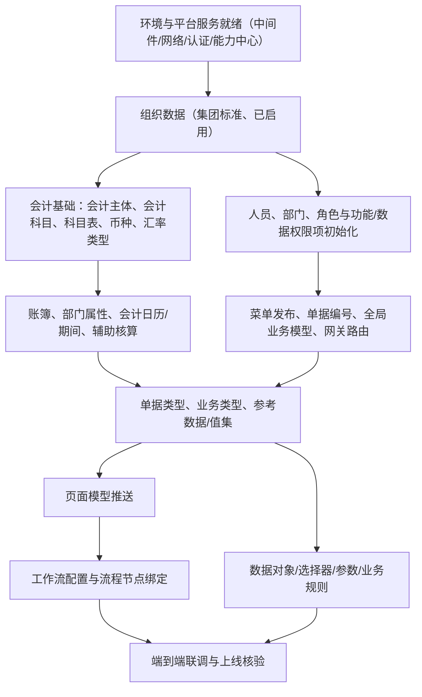
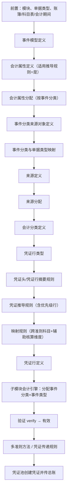
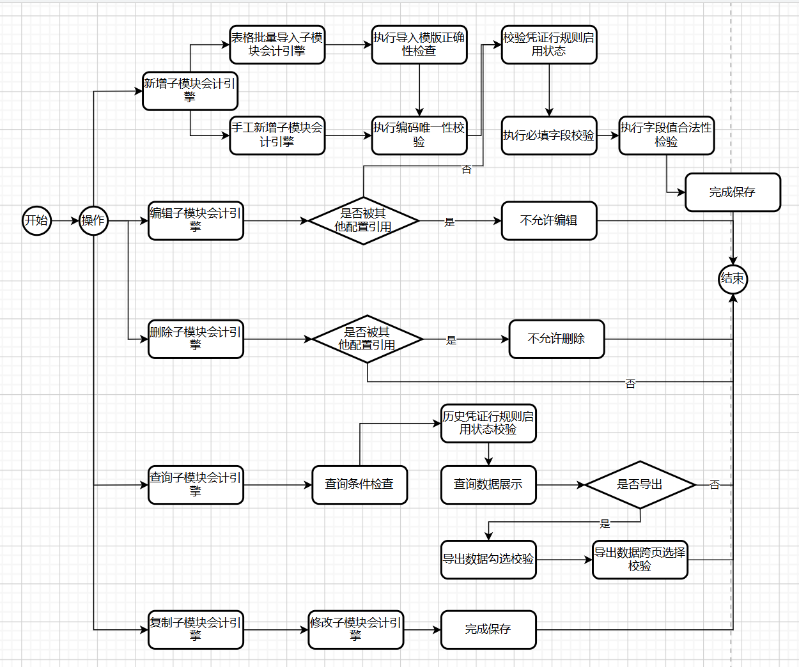
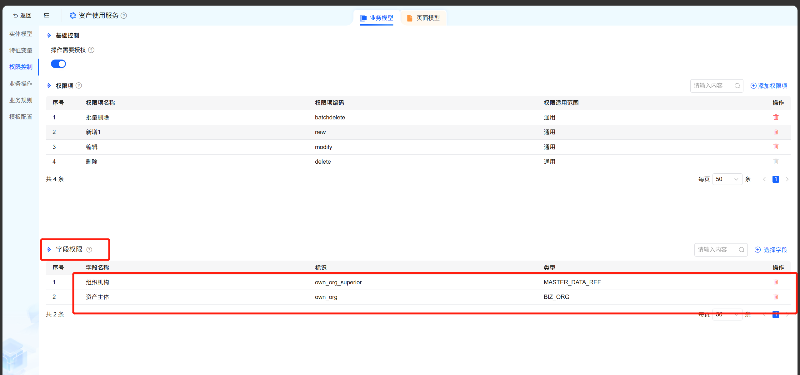

# 05 配置与实施注意事项

> 这一篇是实施顾问的主战场，也是前端最容易「莫名其妙提测不过」的根因所在。

## 1 通用原则（背下来）

1. **先配没有内部依赖的基础配置，再配带前置依赖的业务规则、账户、风控、计划类配置。**
2. 配置手册里每条配置都有六列：配置名称 / 配置类型 / 关联业务对象 / 配置要求（必选·可选）/ 依赖应用 / **依赖配置**。**「依赖配置」列就是上线排序的直接依据。**
3. 系统预置的**参考数据**（币种、汇率类型、关联方类型等）实施人员**不需要新建，只需核验完整性**；但实施账号本身必须先由系统管理员开通功能权限 + 匹配数据范围的**数据权限**。

## 2 新增一个业务模块：从 0 到上线 10 步

| 顺序 | 事项 | 关键入口 | 主要产出 |
|---|---|---|---|
| 0 | 应用服务在基础平台开放 | 系统管理 > 应用管理 > 服务管理 > 【功能管理】 | 功能菜单树、操作权限标识、业务模型关联 |
| 1 | 组织（组织机构 / 公司 / 部门） | 基础平台组织机构 | 组织维度可用（后续会计主体、单据、审批人、数据权限都按它挂） |
| 2 | 会计主体 + 账簿 | 主数据平台、账簿管理 | 会计主体启用、账簿与主体绑定、辅助核算规则 |
| 3 | 单据类型、编号规则、值集 | 基础设置 > 公共设置 / 基础应用 > 单据类型 | 单据类型可查、编号规则生效 |
| 4 | 业务模型（低开） | 应用开发 > 对应服务 > 低开模块 > 【开发】 | 页面/实体模型、**操作授权开启**、权限项绑定业务操作 |
| 5 | 菜单注册 | 功能管理挂载菜单 | 导航可见 |
| 6 | 角色与权限 | 权限管理 > 角色管理 > 业务角色 | 标准角色 + 业务角色，功能权限 + 数据权限 |
| 7 | 审批流程 | 流程配置 + 绑定系统操作 | 三段式节点 + 通过/退回/拒绝回写 |
| 8 | 参数与业务规则 | 参数配置、业务规则 | 参数项、主表/子表规则 |
| 9 | 测试与上线验证 | 权限与流程回归 | 上线清单 |

### 各步的关键细节

**第 0 步**：`系统管理 > 应用管理 > 服务管理` 找到已开放的应用服务 →【功能管理】：左侧树是「应用开放的功能菜单」，右侧「操作列表」增删改查操作权限标识，右侧「业务模型」维护操作标识关联的业务模型（执行接口时操作到的表）。

**第 2 步 会计主体与账簿（财务模块最关键的硬前置）**
- 会计主体属主数据管理平台维护的主数据，在会计主体管理菜单完成新增/查看/编辑/启停。
- 新增账簿必填：**财务账簿、账簿类型、账簿编码、账簿名称、会计准则、科目表、会计日历、初始期间、本位币币种、使用状态、有效日期范围、备注**；账簿与会计主体分别选择并关联，弹窗内「包含会计主体」后执行【启用】。
- 涉及辅助核算还要按「账簿 + 会计主体 + 辅助核算 + 默认值」配辅助核算规则。
- **推荐顺序**：会计主体 → 科目表 / 会计日历 / 期间 → 账簿 → 账簿与主体绑定启用 → 辅助核算规则。

**第 3 步 单据类型**：编号由系统自动生成、全系统唯一、不可重复；名称手工输入并做去空格与重复性校验；**编码新增时自动生成、禁止修改**，且是关键查询条件。单据编号由「单据类型/业务类型」带出。

**第 4 步 业务模型**：模型内按页签核对 `业务模型 → 页面模型/实体模型 → 特征变量 → 权限控制 → 业务操作 → 业务规则 → 模板配置`；**「权限控制 → 操作授权」开关必须启用**；权限项先搜库中是否已存在，不存在再新增；在「业务操作」里给需要管控的操作（如 `new`、`newentry`、`saveandnew`）绑定权限项。

**第 6 步 角色**：先建**标准角色**（经办、业务审批人、财务审批人、系统管理员/运维），再建**业务角色**（可参考标准角色创建，支持导入导出）；业务角色默认集成标准角色的数据权限与功能权限，建好后点【配置权限】细化。

**第 7 步 流程**：财务类单据常规是「发起 → 业务审批 → 财务审批」三段式；在流程/业务模型侧「绑定系统操作」，勾选 `final_approve`（审批通过）、`final_return`（退回）、`final_reject`（拒绝）；单据表要具备 `process_instance_id`、`process_id`、`current_node_code`、`approval_status`、`biz_status` 承载流程状态；走共享作业的还要在共享中心新增子流程（子流程编码、名称、单据类型、共享中心）。

**第 8 步 参数与规则**：模块级参数按「参数名、参数名称、参数类型」新增（示例：`acctEntityList` 会计主体、`ledgerList` 账簿、`legalEntityList` 法人、`periodCode` 期间）；**业务规则涉及主表、子表时每张表都要单独配规则** —— 只配主表会导致分录层规则不生效，这是高频漏配点。

## 3 上线的初始化依赖顺序（五层）

### 几条原文写明的关键依赖

- **组织数据**依赖「主数据中组织数据已按集团标准维护并启用」；申请人依赖平台人员组件；所属部门从组织管理同步。
- **业务类型是依赖最多的节点**：依赖组织机构、账簿、部门属性、会计科目、资金计划类型、现金流量项、税收分类编码、单据类型、开票类型、税率。
- 「标准类型」依赖先在【系统管理-基础资料-数据对象】完成**数据对象属性管理 + 数据对象定义**。
- 会计科目必须挂在科目表下（所属科目表为必填外键）。
- 账户体系是三级链：**账户类别（无依赖）→ 账户性质（依赖类别）→ 账户用途（依赖类别+性质）→ 是否推送司库（依赖三者）**。
- 资金认领分类前置需要「单据类型、会计科目」；金融机构配置需先有「类别、国家、省份、城市」；管理组织认领规则依赖「管理组织、资金认领分类、款项性质、现金流量项、资金用途」；提醒规则又依赖认领规则。
- 挂账单科目配置需提前维护「管理组织、会计主体、会计科目、现金流量项、资金中心内部户、资金用途、金融机构、客商、银行账户」。
- **页面模型推送是工作流的前置** —— 先配工作流后推页面模型，工作流建不出来。

### 配错会怎样（后果对照表）

| 配置项 | 配错的表现 | 后果 |
|---|---|---|
| 实施账号数据权限 | 只授权了部分会计主体 | **数据权限控制会计主体、企业会计科目、客商等帮助列表的可选范围**，多主体集中配置时查不到、配不全 |
| 功能权限项/数据权限维度未初始化 | 只建角色不初始化权限项 | 按钮权限无承载对象：角色里看不到按钮、菜单能看到但操作不可用 |
| 页面模型推送 vs 工作流 | 顺序颠倒 | 工作流创建/绑定失败，单据提交后无流程实例 |
| 账户类别 → 性质 → 用途 | 跳过类别直接建性质 | 下拉无值，后续「是否推送司库」无从配置 |
| 业务类型 | 单据类型/税率为空 | 业务类型建不出来或性质定义不全，单据无法归类、记账取数异常 |
| 组织数据 | 未按集团标准维护或未启用 | 申请人、所属部门、数据权限全部连带缺失 |
| 会计科目/科目表 | 科目未挂科目表 | 账簿、凭证、科目配置类功能取不到科目 |
| 参考数据 | 只配业务、不核验参考数据 | 币种/汇率类型下拉取值缺失，引用字段为空 |

## 4 上线检查清单（按阶段勾）

### 阶段 A 环境与平台（所有模块共用）
- [ ] 目标环境（DEV/TEST/STG/PROD）就绪
- [ ] 中间件（BCS/BES MQ/Kafka/DCS-Z/Datasearch/MinIO/OceanBase）部署可用
- [ ] 应用服务器到中间件 IP/端口网络连通
- [ ] 各环境认证信息（domain/key/secret/账号密码）已获取
- [ ] 能力管理中心、编号中心、消息中心、统一集成平台可访问
- [ ] dev/test 配置导出文件已备好（编号配置用）；参考代码已导入

### 阶段 B 平台底座
- [ ] 组织数据按集团标准维护并**启用**
- [ ] 所属部门从组织管理同步完成；平台用户/申请人建立
- [ ] 角色配置完成并**分配用户**；功能权限项与数据权限维度初始化完成
- [ ] 应用菜单发布；全局业务模型创建；网关路由配置完成
- [ ] 客商、地址（洲/国/省）等公共主数据完成

### 阶段 C 会计基础
- [ ] 会计主体创建并启用
- [ ] 会计科目按科目表维护（外键回填成功）
- [ ] 币种、汇率类型核验（参考数据，只核验不新建）
- [ ] 账簿创建（含会计准则、科目表、会计日历、初始期间、本位币、有效日期）
- [ ] 账簿与会计主体绑定启用；部门属性维护完成
- [ ] 现金流量项、资金计划类型、税收分类编码、开票类型、税率齐备

### 阶段 D 单据与字典
- [ ] 单据类型、单据编号配置完成
- [ ] 编码规则验证：新增单据能自动生成不重复编号
- [ ] 业务类型配置完成（依赖项到位后再配）
- [ ] 参考数据/全局下拉核验完整
- [ ] 数据对象（属性管理 → 定义）→ 标准类型；选择器指向正确数据对象

### 阶段 E 模型与流程
- [ ] 低开模型「操作授权」启用，权限项已绑定业务操作
- [ ] **页面模型推送完成**
- [ ] 工作流节点（发起/业务审批/财务审批）与审批人规则正确
- [ ] `final_approve / final_return / final_reject` 已绑定

### 阶段 F 参数、规则与接口
- [ ] 参数管理配置并生效
- [ ] 业务规则按主表**和每张子表**分别配置
- [ ] 集成平台 API 检查、MQ 检查完成
- [ ] 需迁移的基础数据脚本已验证

### 阶段 G 部署后验证（每项都是上线门禁）
- [ ] Kafka 连接正常（流程引擎 bpm、cap 数据中心）
- [ ] ipaas 认证成功（domain 可达、serviceId/secret 正确）
- [ ] mdm 接收 ipass 数据配置正确（STG 环境无需配置）
- [ ] 数据库、Redis/BCS 缓存、Kafka/BES MQ 连接正常

## 5 会计引擎配置（七块规则库）

会计引擎是「规则库」架构，共七块：**事件模型库、来源规则库、分录规则库、凭证行规则库、子模块会计引擎、多准则会计方法库、凭证池**。

具体菜单：
- **事件模型库**：事件模型定义、会计属性定义、会计属性分配、事件分类来源对象定义、事件分类与单据类型映射
- **来源规则库**：来源定义、来源分配
- **分录规则库**：会计分录类型定义（部分文档称「会计分类定义」）、凭证行类型、凭证头摘要规则、凭证行摘要规则、凭证推导规则、映射规则
- **凭证行规则库**：凭证行定义
- **子模块会计引擎 / 多准则方法 / 凭证池**（凭证传递规则、凭证池、子模块凭证列表）

> 同一节点在不同版本文档里有两种命名（「会计分录类型定义」vs「会计分类定义」），落地以环境实际菜单为准。批量配置靠**导入模板/复制**，不要手工逐条点。

### 配置顺序（依赖驱动）

### 高频配置错误（都是验证会拦下的硬约束）

| 环节 | 约束 | 后果 |
|---|---|---|
| 事件模型定义 | 参考对象为「表」或「单基表视图」时，连接链末端头级业务对象也必须是表/单基表视图 | 子模块引擎验证不通过 |
| 会计属性定义 | 被启用推导规则引用的会计属性，「适用推导规则」必须为「是」 | 验证失败 |
| 会计属性分配 | 子模块引擎验证会检查「事件分类 + 事件类型」是否已分配 | 提示「请先完成分配后再验证」 |
| 事件分类与单据类型映射 | 被其他配置引用时**不允许编辑/删除** | 改不动，只能新增映射 |
| 凭证行类型 | 借贷方向为「损益」时，其下每条启用推导规则的「推导规则借贷方向」必须非空 | 验证失败 |
| 凭证推导规则 | 每条启用规则**至少一个优先级行**；生效条件表达式括号匹配、语法合法 | 验证失败；取值优先级错会导致取错科目 |

**映射规则**（跨准则场景）：定义不同准则下科目与辅助核算维度值的一对一/多对一对应关系；主表含模块编码、规则编码（唯一）、5 组输入类型+输入科目表/值集、5 组输出类型+输出科目表/值集、生效/失效日期、状态；新增时**必须同时维护映射规则、映射值集、映射值三者并建立关联**。注意**模块字段用于数据权限联动**：模块为空 → 任何推导规则都能选；模块非空 → 推导规则不能选模块值不同的映射规则。

## 6 权限模型（RBAC 五层）

### 结构

**菜单（功能）→ 按钮（操作）→ 数据范围 → 行级 → 列级**，自上而下金字塔。
人员不直接挂权限：**用户 → 岗位（分配人员）→ 业务角色 BR →（引用）标准角色 SR → 功能权限 + 数据权限**。多角色时权限**取并集**（不是覆盖），这点必须写进设计说明。

### 四类权限怎么配

**1）菜单权限**
- 授权对象是「L3 应用下的菜单节点」。
- 交付物是一张**菜单权限清单**：一级菜单 / 二级菜单 / 三级菜单 / 按钮功能 / 角色（落地 Excel 版还多「操作按钮 / 权限分配 √ / 备注 / 范围权限」）。
- ⚠️ 清单里菜单层级字段是**稀疏填充**的（只在分组首行有值），导入系统前必须向下填充，否则权限挂错层级。

**2）按钮权限（权限项）—— 新增页面最核心的一环**
- 链路固定：业务模型 → **权限控制** → 开启「操作需要授权」→ 维护权限项（名称 + 编码 + 适用范围「通用 / 当前模型」）→ 绑定业务操作。
- **权限项编码必须等于页面模型中按钮的「操作代码」**（选中按钮可查看，如 `delete`）；重名时按编码判断而不是按名称。
- 命名建议 `业务对象前缀 + 动作`，如 `PolicyDocument-add`、`PolicyDocument-batchDelete`、`LabelTemplateManagement-edit`。
- 按钮权限不只是显示/隐藏：还有按钮类型（主/次/文字/危险）、图标、过多折叠为「更多」、**禁用态配置**（不满足业务条件置灰）、高风险二次确认、成功后刷新列表。

**3）数据权限（三层）**
- **范围权限**：按组织、部门、项目、标段、参建方、合同等维度划分归属，四种通用模式：本节点 / 本节点及下级 / 指定节点 / 全部节点。**多维之间取交集** —— 例如组织=A、资产主体=A1、管理部门=B11（不属于 A1）→ 结果为空；只填管理部门=B11、其他留空 → 展示 B11 全部数据（**空维度不参与过滤**）。这是最容易配错的地方。
- **行级权限**：控制同一页面能看到哪些行，典型条件「管理部门 等于 当前用户所在机构」（见下图）。验收口径：A 组织管理员只能看 A 组织数据；资产报账按资产主体隔离，普通用户只看本人提交/待处理，本公司管理员可跨部门，上级单位可申请查看下级。
- **列级权限（字段权限）**：低开模型在「字段权限」里登记受控字段（如组织机构 `own_org_superior`、资产主体 `own_org`）；高开侧把字段属性类型设为「管控维度」。
- ⚠️ **顺序很重要**：先把字段配成管控维度，数据权限配置界面才会出现该维度，再到【产品管理】关联业务模型、给权限模型配属性。

### 新增功能页面的权限配置顺序

菜单注册 → 页面模型按钮操作代码确认 → 权限项（名称/编码/适用范围）→ 业务操作绑定 → 标准角色/业务角色授权 → 字段配管控维度 → 范围/行级/列级数据权限 → 按「菜单+按钮+角色」清单回归。

## 7 本篇的待确认项

- **数据字典/值集的独立维护入口与导入导出步骤**：未检索到原文，按平台「基础设置 > 基础数据/值集」实际菜单确认。
- **上线发布（版本发布、灰度、生产参数同步）标准流程**：未检索到原文，需向 DevOps/发布管理岗确认。