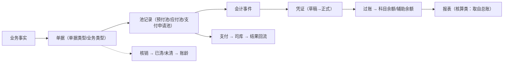

# 08 财务名词表

> 规则：一句话解释，来自产品说明书、详细设计的「术语定义」章节或系统界面字段原文。文档没有定义条款、只能从科目或字段反推的，标注「反推」；完全没证据的标注「⚠️ 未取证」。

## 1 核算基础（先懂这 10 个）

| 名词 | 一句话解释 |
|---|---|
| **账簿** | 一个独立的会计核算体系，决定科目表、辅助核算表、核算规则、币种、日历、会计主体等基本设置，是账务数据的边界 |
| **主账簿** | 遵循主体会计准则（如 CAS）做日常核算的主要账簿 |
| **副账簿 / 辅助账簿** | 为满足其他报告准则（如 US GAAP）设置的并行账簿，通过差异化规则与主账簿区分 |
| **会计主体** | 会计确认、计量和报告的空间范围；独立开展经济活动、单独核算、独立编制报表的单位，并与法人关联 |
| **会计科目** | 分类记录经济业务的科目，具备编码、名称、属性、层级等基本属性 |
| **期间 / 会计期间** | 为核算划出的等长时间区间（月、季），状态含未打开、打开、关闭、永久关闭（部分文档另有「未来期」） |
| **会计日历** | 支持按不同核算主体或业务场景设置专属会计周期规则的日历体系 |
| **辅助核算** | 会计科目之外的多维度明细核算字段，如客商、款项性质、项目、内部往来、成本中心、合同、银行账户 |
| **核算规则** | 定义在何种条件下**必须、禁止或可选**录入哪些辅助核算维度的规则集合 |
| **动态辅助核算维度** | 根据科目和账簿配置动态显示的核算字段，显隐与必输由系统预置的核算规则控制 |

> ⚠️ 资产核算模块有平行口径：「账簿」在那里指「独立的资产核算体系，决定资产折旧方法」，「会计主体」对应「资产主体」。概念同构但域不同，跨模块看文档时别混用。

## 2 凭证与账务处理

| 名词 | 一句话解释 |
|---|---|
| **凭证管理** | 记账凭证的全生命周期管理：制单、审核、过账、查询、冲销、打印、归档 |
| **凭证草稿** | 凭证已创建并保存，但**尚未提交为正式凭证**，可编辑、可删除 |
| **正式凭证** | 由草稿提交后进入审核（或无需审核）流程的凭证；会计引擎创建凭证时类型就是「草稿 / 正式」二选一 |
| **凭证类别** | 凭证的业务分类，如记账凭证、收款凭证 |
| **凭证过账** | 将**已审核**凭证数据正式更新至总账科目余额的操作；过账后凭证通常锁定，无法直接修改 |
| **已过账** | 过账成功终态，金额已更新到相应科目余额、辅助余额 |
| **凭证冲销** | 对**已过账的错误凭证**做更正，主要方法为红字冲销（金额取反）与借贷冲销（科目互换） |
| **冲销（应收语境）** | 对已记账的错误或需调整的应收/收款凭证，做一笔反向分录（红字/负数）来更正，消除错误影响但保留完整审计线索，会产生更正性红蓝字凭证、影响科目发生额 |
| **作废** | 在记账或形成正式应收凭证**之前**，对信息错误、重复提交或业务取消的无效单据标记失效、停止后续处理；**不产生凭证、不影响账务** |
| **已冲销** | 该凭证已被冲销，系统生成一笔冲销凭证 |
| **凭证状态** | 审批链路中的状态：草稿、审核中、已驳回、需要重新审核、已审核、无需审核；「已驳回」「需要重新审核」都会从正式凭证**退回草稿** |
| **过账状态** | 记账链路中的状态：未过账、过账中、过账失败、已过账 |
| **冲销状态** | 凭证冲销标记：空（默认，须「过账状态=已过账」才可冲销）、已冲销等 |

## 3 往来与清算

| 名词 | 一句话解释 |
|---|---|
| **核销** | 把收到的客户付款与对应应收账款**匹配、勾对、清零**的过程（收款单核销应收单、预付款抵减应收款，或用票据/信用证/债权转让清算）；产生往来清算记录，**不影响期间损益** |
| **已清 / 未清** | 判断规则是「剩余未清金额 = 0」：等于 0 时相关报账与核销冲减单据标识「已清」，否则为空 |
| **账龄** | 按每笔未清款项的起算点与报表日/基准日/核销日之间的**自然日天数**归入区间；本系统分五段：6 个月以内、7 个月至 1 年、1–2 年、2–3 年、3 年以上。起算点按业务特色锚定 |
| **数据分类（账龄报表）** | 标识每笔经营性资产及对应坏账准备的凭证行在报表中的归属区域：基准日存量、基准日压降、基准日后新增、新增余额 |

## 4 应付、预提与预付

| 名词 | 一句话解释 |
|---|---|
| **预提计提申请单** | 计提、预提业务的申请单据，编码规则 `YTJT + 日期 + 序号`，含计提结算类型（JTJT）与冲销方式（CXFS） |
| **预提（会计表现）** | 典型分录：借 6602 管理费用 / 贷 220202 应付账款-暂估应付 —— 费用先入账、应付以暂估形式挂账 |
| **暂估应付** | 尚未取得正式发票或结算但已确认的应付，通过「应付账款-暂估应付」科目挂账（反推：文档只给科目名称与分录证据） |
| **预付（预付池）** | 已预先支付、尚未核销的款项，在预付池中按单据编号、单据类型、所属组织/部门、业态、**核销标志**、使用状态管理 |
| **预付申请单** | 发起预付款的业务单据，与「合同付款明细」通过「预付申请单主键编号」一对多关联 |
| **预付核销行** | 应付报账单/付款申请单里用于抵扣既有预付记录的行；选择预付记录后自动带出业务类型、单据类型，且禁止修改 |

## 5 单据与状态

| 名词 | 一句话解释 |
|---|---|
| **单据类型** | 标识单据所属业务类型的分类字段，有编码（Document Type Code）与名称两列；预付行场景专指「预付记录的**入账单类型**」 |
| **源单编码** | 记录该条数据的来源单据编码，用于追溯上游业务 |
| **款项性质** | 用款/收款场景对应的性质分类，**主要用于确定应付/应收科目** |
| **单据状态** | 草稿 → 审批中 → 已完成 →（已冲销）；另可草稿直接作废为「已作废」 |
| **审批状态** | 10 种：草稿、进行中、已完成、已退回、已拒绝、异常、挂起、已撤回、已终止、退回至发起人 |
| **池记录** | 单据在某处理阶段的台账行，如应付池记录、支付申请池记录；与源单通过编号关联 |
| **占用明细** | 池记录对资金计划/应付记录的占用行，支撑「一张单分多次付款」「多单合并付款」 |
| **业务类型** | 报账类单据的业务分类，决定单据类型、税率、会计科目等取值（是配置依赖最多的节点之一） |

## 6 名词地图（怎么用这些词）

## 7 ⚠️ 未取证

- **合并报表 / 对账**：本轮检索未找到定义条款。合并报表规则在「财务报告/报表管理」里维护，但具体术语定义缺口存在。
- **成本管理域**（成本核算、生产成本、库存计价、成本分析）：只在架构清单里出现，产品定位细节未深入检索。
- 若需要补全，指定模块名再问知识库，或直接找对应应用负责人（总账/报表 → 刘福、葛琦）。