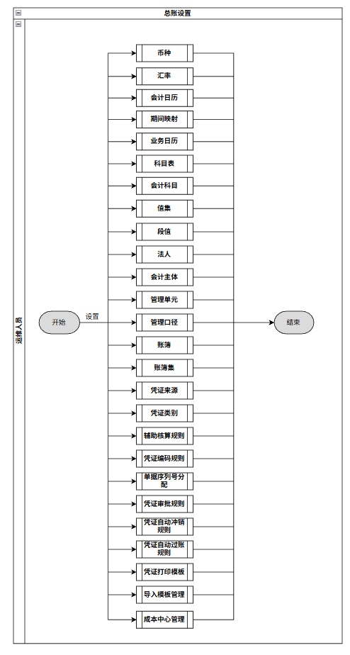
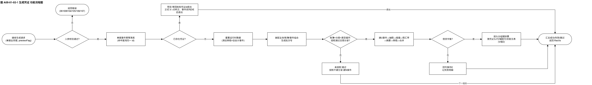

# 11 实施配置作战手册：从空租户到第一张凭证

> **什么时候用得上**：接到一个新租户/新会计主体，要“三天内跑通第一张凭证、第一笔付款”。<br>
> **怎么用**：按 §1 的九层顺序配，每配完一层用 §2 的“漏配报错”自检一遍。<br>
> **证据口径**：本篇是从知识库里的**报错码、配置手册、测试用例**反向还原出来的最小配置集，不是官方 checklist——凡没取到的，末尾「待确认」里都列了。

## 1 九层顺序（先纠一个最常见的错）

新手最容易踩的依赖倒置：**币种、汇率、会计日历必须排在“会计主体与账簿”之前**。因为新增账簿时「本位币、会计日历、科目表、初始期间」都是必填项，账簿建不出来，后面的期间、凭证、引擎全部无从谈起。

产品自身的总账设置主流程（可以当作标准参照）：

```
币种 → 汇率 → 会计日历 → 期间映射 → 业务日历 → 科目表 → 会计科目 → 值集 → 段值
→ 法人 → 会计主体 → 管理单元 → 管理口径 → 账簿 → 账簿集 → 凭证来源 → 凭证类别
→ 辅助核算规则 → 凭证编码规则 → 单据序列号分配 → 凭证审批规则 → 自动冲销
→ 自动过账 → 打印模板 → 导入模板
```


<small>图 11-1 总账设置主流程（知识库原文图，来源 image id `Mj7Vked6qYz3oNM-nlHa4w`）</small>

实际落地时还有一层**第 0 层**常被清单漏掉：主数据与权限。

| 层 | 内容 | 为什么要它 |
|---|---|---|
| **第 0 层** | 组织机构、人员、客商、合同、物料、项目；人员账号的查询/新增/编辑权限；覆盖目标会计主体/科目/客商的数据权限 | 应收报账的初始化前置条件就是「组织机构、人员、客商、合同、物料、项目、币种、汇率字典维护完成」；数据权限决定「会计主体、科目、客商」帮助列表的可选范围，没覆盖就选不到值 |
| **第 1 层** | 币种+本位币、汇率类型+汇率、会计日历+期间映射+业务日历、科目表+明细科目+值集/段值、法人→会计主体→管理单元 | 账簿必填项的来源；凭证行只能用**明细科目**；日历缺失时凭证日期定位不到期间 |
| **第 2 层** | 会计主体（含 `initial_period` 如 202601）→ 账簿 → 账簿集 | 账簿不存在，引擎直接抛「账簿未绑定可用会计引擎」 |
| **第 3 层** | 同步会计日历 → 期间管理把 202601 及后续置为“打开”（其余留“未来期”） | **最容易卡死第一张凭证的一环** |
| **第 4 层** | 凭证来源 → 凭证类别（凭证字）→ 凭证编码规则（规则明细 + **分配到账簿/类别**）→ 单据序列号分配 | 只建规则不做“分配”，规则对该账簿不生效 |
| **第 5 层** | 外币：汇率类型 + 汇率日期 + 汇率值；凭证行类型的必填会计属性里要带「汇率」 | 只做本位币业务可不配外币，但本位币（第 2 层必填）必须有 |
| **第 6 层** | 税码税率 | ⚠️ **知识库未取到**配置项/必填校验/报错文案，只确认存在「税务开票接口连通」初始化项 |
| **第 7 层** | 单据类型同步/启用 + 单据类别号分段（若启用）+ 单据类型→会计事件分类映射 | 单据类型存在但没映射事件，引擎抛「单据类型未匹配到事件分类」 |
| **第 8 层** | 按组织配业务审核 / 财务审核审批流 + 凭证审批规则 | **凭证生成节点常挂在审批节点上**；审批流没配，单据走不到财务节点，凭证预览/生成根本触发不了 |
| **第 9 层** | 会计引擎：账簿绑定引擎、事件启用+验证、抽取、借贷平衡、汇率、推导规则、凭证池 | 见 §2 的引擎报错对照表 |

### 一个必须知道的机制

新增账簿的必填字段：**账簿编号、账簿名称、财务账簿、集成方式（如过账）、会计准则、科目表、会计日历、初始期间、本位币**。会计主体的开账期间由 `initial_period`（如 202601）决定。

## 2 漏配报错对照表（拿去当自检清单）

| 缺什么 | 报错码 / 提示 | 层级 |
|---|---|---|
| 期间未打开或已关闭 | `0610010113 {0}期间未打开或已关闭，不允许录入凭证` | 3 |
| 期间记录不存在 | `0610010112 {0}期间不存在` | 3 |
| 凭证日期不在期间范围 | `0610010114 {0}凭证日期不在{1}期间有效日期范围内` | 3 |
| 日历中找不到日期对应期间 | 界面提示「在日历 1001 中未找到日期 2026-08-01 对应的期间」 | 1/3 |
| 账簿不存在/被删/失效 | `610010001 账簿：{} 不存在或已被删除`、`0610010155`、`0610010109`、`0610010111` | 2 |
| 账簿未绑定引擎 | `061009109 账簿未绑定可用会计引擎` | 2/9 |
| 科目不存在/已停用 | `0610010153 科目{0}不存在或已停用` | 1 |
| 科目非明细级 | `0610010154 科目{0}非明细级` | 1 |
| 科目未取到核算信息 | `0610010156 科目{0}未获取到对应的核算信息` | 1 |
| 凭证类别不存在/失效 | `0610010107 {0}凭证类别不存在，请检查`、`0610010108` | 4 |
| 编码规则维度不存在 | `610010149 凭证编码规则维度不存在` | 4 |
| 凭证编号消息队列未配 | `610010150 / 610010151 未获取到凭证编号生成的消息队列配置，请检查` | 4 |
| 序列号重试耗尽 | `0610010717 生成序列号到最大重试次数` | 4 |
| 汇率取不到 | `061009115 汇率未取到`；接口返回「未取到 USD→CNY 汇率（2026-06-30 SPOT）」 | 5 |
| 行类型必填属性“汇率”为空 | `061009139 行类型必填会计属性「汇率」为空` | 5/9 |
| 单据类型未映射事件分类 | `061009110 单据类型未匹配到事件分类` | 7/9 |
| 单据事件不存在 | `542017120 单据事件不存在` | 7 |
| 引擎事件未启用或未验证 | `061009111 引擎事件未启用或未验证` | 9 |
| 抽取头数据不存在 | `061009112 抽取头数据不存在` | 9 |
| 借贷不平衡 | `061009113 借贷不平衡` | 9 |
| 推导规则未命中 | `061009116 推导规则未命中` | 9 |
| 幂等冲突 | `061009114 该会计事件已生成凭证（幂等冲突）` | 9 |
| 凭证规则根本没配 | 财务审核页点【凭证预览】→ 弹窗「**当前单据类型未配置凭证生成规则**」，且不生成预览凭证；费用报账侧提示「凭证生成失败 / 无匹配做账规则」 | 9 |
| 凭证池侧入参问题 | `542017104 引擎入参不能为空`、`542017105 引擎入参缺少必填字段`、`542017118 总账凭证传送失败` | 9 |


<small>图 11-2 引擎内部链路：装配主体+账簿+事件组合 → 循环“账簿×分类×类型”建 U 事件 → 抽取赋值 → 取汇率 → 生成摘要草稿 → 判断借贷平衡 → 拆票落库；未授权组合直接跳过并建 N 事件（来源 image id `eIAaDfaziR_NH7qIpNWKWw`）</small>

## 3 第一笔付款还多一层：资金侧前置

资金管理手册给出的依赖顺序：**前置依赖（主数据/审批/权限/管控平台）→ 基础配置 → 规则配置 → 账户体系 → 风控 + 计划 + 策略**。

要真正付出第一笔款，至少还要：

- **金融机构、银行账户、资金中心内部户、资金用途、现金流量项**（挂账单科目配置就要求这些主数据先维护完成）
- **结算方式字典**（依赖计划控制颗粒度配置）
- **账户档案 + 账户余额初始化**
- **付款风控、资金计划**（都可能拦截支付）

> ⚠️ 付款侧的具体报错文案（“账户未配置”“超出资金计划”等）知识库未取到。

## 4 会“直接卡住业务”的漏配（按阻断强度排序）

1. **会计期间未打开** → 凭证录入直接拒绝（`0610010113`）
2. **账簿不存在 / 未绑定引擎** → `610010001` / `0610010155` / `061009109`
3. **凭证类别 / 编码规则未分配** → `0610010107` / `610010149` / `610010150`
4. **科目非明细 / 不存在** → `0610010154` / `0610010153`
5. **单据类型未映射事件分类** → `061009110`
6. **会计引擎凭证规则未配** → 预览弹「当前单据类型未配置凭证生成规则」，不生成凭证
7. **外币汇率缺失** → `061009115`
8. **审批流未配** → 单据到不了财务节点，凭证预览本身就无法触发
9. **期间关闭时遗留未过账凭证** → 关账提示「XX期间总账存在YY条未过账凭证，请确认是否关闭？」；月结提示「该期间存在未入账或入账失败的单据，请执行关账例外检查」

## 5 导入：所有模块共用的四规则 + 一条铁律

统一的导入弹窗文案（会计科目、科目核算设置、分录规则、凭证导入都一样）：

1. 必须使用提供的模板格式
2. **单次不超过 10000 行**
3. 仅支持 **xlsx**
4. **一次只能上传一个附件**

分录规则 / 经常性凭证类导入多一条：xlsx 且 **不超过 100M**。

- **模板集中管理**：`总账设置 → 导入模板管理 → 导入模板上传`。已有功能项：科目核算、期间明细、工作日导入、汇率、折算规则、凭证来源。换模板/补模板都从这个入口进。
- **导入任务可追溯**：结果列表字段为 序号 / 开始时间 / 运行时长 / 模板 / 上传者 / 状态 / 操作（详情）。
- **铁律：导入是“部分成功”模式，不是全有全无。** 引擎映射规则导入的结果页会显示“成功 20 条、失败 5 条”，并逐条列出失败明细。**割接时必须按失败明细逐条处理，否则会留下半成品数据。**
- 模板不匹配的统一提示：「导入失败，批量导入模板错误 / 请下载指定模板后再次上传」，并给「重新上传」按钮。

## 6 期初与割接：先认清证据强度

| 期初数据类型 | 入口 | 证据强度 |
|---|---|---|
| **资产期初** | 资产核算 → 资产期初初始化 → **资产卡片及价值导入**（字段清单与逐字段校验用例齐全） | ✅ 强 |
| 科目余额 | 未取到专用期初导入入口 | ⚠️ 弱 |
| 往来未清项 | 未取到 | ❌ 无 |
| 未核销预付款 | 未取到 | ❌ 无 |
| 在途单据统计 | 未取到 | ❌ 无 |

科目余额侧只取到“结果口径”：
- 试算平衡表/科目余额表里，「本位币期初余额」由系统自动带出；
- **期初余额方向判定**：> 0 为「借」，< 0 为「贷」，= 0 为「平」；
- 非会计年度首个期间时，期初余额来自“上期结转”。**这说明系统内存在“期间结转”与“割接期初导入”两条不同路径，割接时要先确认走哪条。**

应付核算里确实有 `应付单 Excel 导入`、`付款单 Excel 导入`，但那是**日常单据导入**，数据形态里没有「已核销金额 / 剩余金额 / 到期日」这类历史状态，不能直接拿来当期初未清项。

> ⚠️ 往来未清项、未核销预付款、在途单据这三类的导入入口，**必须找实施/核算组当面确认**，别照着日常单据导入硬做。

## 7 本篇的待确认项

- **税码税率**：配置项、必填校验、报错文案均未取到 → 查税务/发票模块配置手册。
- **审批流未配置的系统级报错码**：只确认会阻断流转，未取到报错。
- **付款侧报错文案**：银行账户、结算方式、资金计划、风控的具体拦截提示未取到。
- **科目余额、往来未清项、未核销预付款、在途单据的期初导入入口与模板**：未取到，需当面确认走“期间结转”还是“期初导入”。
