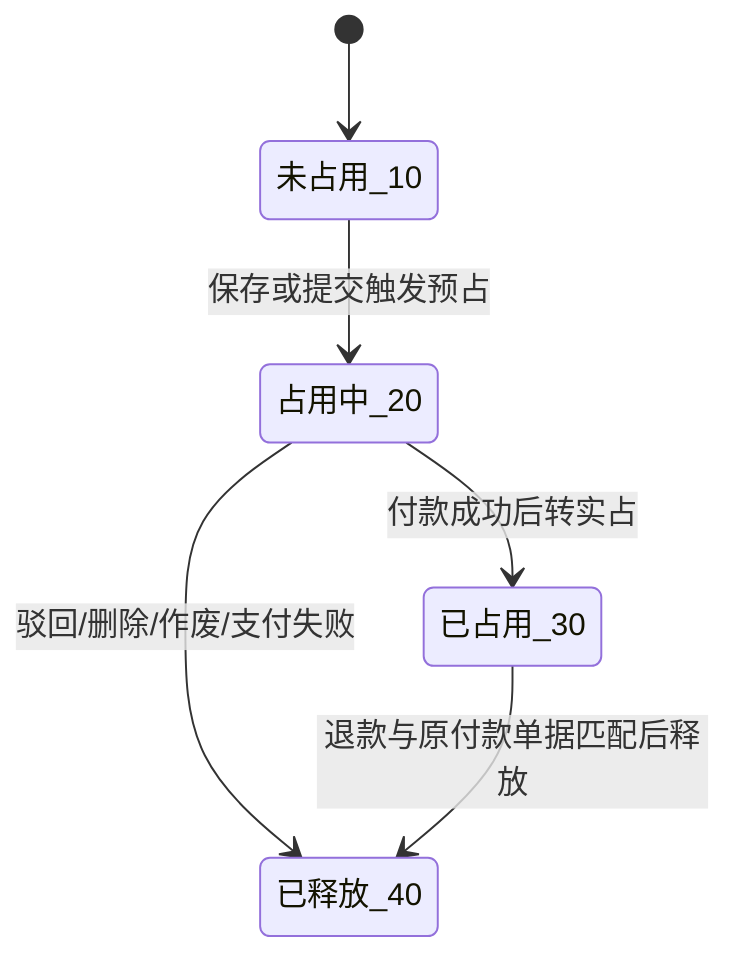

# 12 资金计划与预算控制：预占、实占、释放、追加

> **什么时候用得上**：付款单提交报“额度不足”、月底资金计划余额对不上、被问“预算和资金计划谁先控”。 
> **一句话结论**：资金计划是**“预占 → 实占 → 释放”两段式**，由**保存/提交这一个可配置控制节点**驱动；核销/取消都**不释放**，**只有付款成功才从预占转实占**；超计划按**强控/弱控/不控**三档处理，无计划走**计划调整（增补）**。预算与计划谁先控 → ⚠️ **知识库无证据**（见 §6）。

## 1 两段式结构与四个状态

- 业务单据在**保存或提交时（可配置）预占**，**付款成功后实占**。
- 占用状态四个值：**10-未占用、20-占用中、30-已占用、40-已释放**。
- 占用落库到**计划占用明细表**，字段用 `biz_id`、`biz_serial_no` 关联业务单据、`amount` 记金额 —— **每一笔占用都能回溯到来源系统和单据编号**。

## 2 控制节点：保存 or 提交（配错最麻烦的一处）

系统选项里只有**两个可选值**，按「管理组织 + 单据类型」配置。两种配置下占用与释放规则**完全不同**：

| 控制节点 | 占用时机 | 释放时机 | 释放形式 |
|---|---|---|---|
| **保存控制** | 保存时校验计划余额，有余额即生成占用数 | **单据删除时**释放 | 以负数形式在实占数上体现 |
| **提交控制** | 提交时校验计划余额，有余额即生成占用数 | **驳回申请人（制单节点）时**释放 | 以负数形式在实占数上体现 |

业务需求说明书对同一规则的另一种表述：占用环节为提交时，单据退回编辑状态释放预占；占用环节为保存时，单据作废或删除时释放预占。

流程图分支是：读取控制节点配置 → ①保存控制 / ②提交控制，两条各调一次资金计划校验接口，返回「剩余额度 > 占用数 → 成功并占用额度」或「额度不足 → 失败并带失败原因」。

## 3 应付侧比通用规则多三段（重点验证对象）

1. **应付提交**：所有应付付款单提交时预占用当月资金计划金额、锁定额度；跨月/不跨月都校验是否在当月计划内，**不在计划内则提交报错，需追加计划后结算经办再提交**。
2. **结算经办提交**：不跨月只校验当月计划；**跨月时同时校验“制单占用（历史额度）”和“付款占用（当月额度）”，任一不足都驳回**。
3. **资金结算确认**：全部付款结算成功、结算确认完成时，系统**自动回写执行数**、更新计划余额与占用状态；结算失败/作废则**自动释放预占的当月额度**。

> 也就是说，应付侧的“实占”不是付款成功那一刻写入的，而是**在资金结算确认时批量回写**——这是一条必须单独验证的异步环节。

另外两个特殊场景：
- **预占用时效**：结算单提交时会检查预占用时间是否在允许继续办理的范围内（例如三个月内可继续付款），并区分占用类型（当月/跨月引入）。
- **重付**：重复支付单传结算时**必须携带原支付申请的资金计划信息**，占用金额 = 重付金额，**不重复占用原计划额度**，且要关联原支付申请以支持追溯。

## 4 释放的所有触发点

| 释放触发 | 适用条件 |
|---|---|
| 单据状态退回编辑状态 | 占用节点 = **提交** |
| 单据作废或删除 | 占用节点 = **保存** |
| 驳回至申请人（制单节点） | 占用节点 = 提交，以负数计入实占数 |
| 付款业务结算失败 / 作废 | 自动释放预占当月额度，恢复余额 |
| 退款与原付款单据匹配成功 | 释放原**实占**计划 |
| 员工借款等单据失败/退回 | 由 INT-005 接口统一处理 |

**释放接口两种粒度**：部分释放传「单据编号 + 单据行号 + 币种 + 释放金额」；全部释放只传「单据编号」。统一入口是 **INT-005**（`fin/fm-fim-fus/inner-api/plan/occupy-execute`）。

## 5 追加 = “资金计划调整”

系统里不叫“追加”，能力落在**资金计划调整**上，两个入口：

- **无计划时**：流程判「是否有计划 = 否」→ 进入「资金计划调整」分支，审批通过后回到主流程。
- **额度不足时**：系统给三条建议 —— ①调减本次申请金额至不超过剩余额度；②**联系资金计划管理人员调增计划额度**；③更换支付方式（如现汇改票据）。

**未上报计划的处理**：可通过计划调整功能填报调整单据/重新编制计划并上报，前提是「**需管理权限用户把计划期间状态改为“调整”**」。

还有一个容易忽略的约束：审批节点会**自动向上穿透校验上级周期累计额度**，若待审批单据会导致下级总额超过上级批复上限，**系统自动驳回审批流程**；实际付款占用日/周计划额度时也会同步校验不超过上级周期总额。

## 6 超计划 / 无计划怎么处理

### 三档控制程度决定“拦不拦”

| 控制程度 | 行为 | 执行数归属 |
|---|---|---|
| **强控** | 不可通过 | 计入计划内执行数 |
| **弱控** | 仅提醒，仍可通过 | 计入计划内执行数 |
| **不控** | 直接放行 | 计入**计划外**执行数 |

- 支持**按付款方式差异化**：电汇刚性控制，票据/信用证柔性控制。
- 两个例外：**直属公司（顶点单位）的内部付款单据仅占用、不控制**；同一层级管理组织的两种控制模式**互斥**。
- 校验规则是硬的：付款额度 > 计划剩余金额 → 回传失败状态 + 失败原因；≤ → 回传成功 + 占用/剩余金额并更新实占。
- 提示信息里带「超出金额（###,###.00）+ 币种」，并附前面那三条处理建议。

### 无计划

- 走「是否有计划 → 否 → 资金计划调整」分支，审批通过后再付款。
- 维度层面更严：若采用「**收支计划净额**」维度控制，**必须编制收款计划，无收款计划无法付款**。
- **勾选维度即隐含“必须有该字段”**：勾选项目则付款单必须有项目信息且有计划额度才能付款；合同/供应商/计划类型同理；且**项目、合同、供应商、计划类型是平级控制，选择后同时检查，无先后顺序**。

## 7 预算控制 vs 资金计划控制：能确认的，和不能确认的

| 维度 | 预算控制 | 资金计划控制 |
|---|---|---|
| 接口 | `budget-execute`（`/openapi/budget/execute`） | `plan/occupy-execute`（INT-005） |
| 触发时机 | **单据提交、撤回、退回、审批、审批结束**；点「查询预算」按钮时另调查询接口 | **保存 或 提交（二选一，可配置）** |
| 占用标识 | `formId` 幂等 + `occupyId` | `biz_id` / `biz_serial_no` + `occupyStatus` |
| 可用额字段 | `availableAmount` / `availableQty` | 剩余数 / 占用数 / 实占数 |

> ⚠️ **串行还是并行、谁先校验、一方失败是否阻断另一方 —— 知识库没有证据。**
> 已检索到的资金计划控制流程（含应付与计划的交互图）里**只出现资金计划校验接口，完全没有预算控制接口**，可视为文档层面是**两套独立控制**、各占各的额度（预算 `occupyId` 与计划 `occupyStatus` 互不共享）。

**与其猜，不如用这三个动作实测**（比看文档快）：

1. 同一张付款申请单提交时，抓两个接口的**调用日志时序**；
2. 预算强控拦截后，查资金计划**是否已被预占**（若是，就存在孤立占用，需要回滚）；
3. 资金计划驳回后，查**预算占用是否被释放**。

## 8 本篇的待确认项

1. **预算与资金计划的编排关系**（本篇最关键的缺口）→ 用 §7 三项实测或问架构/产品。
2. **预算侧释放规则**（退回/撤回时占用如何释放、幂等怎么处理）：只取到 `formId` 幂等拦截（错误码 `549014008`）。
3. **资金计划调整单自身的状态机与审批流**：只取到“期间状态需改为调整”，未取到调整单状态字段定义。
4. **资金计划侧的业务错误码清单**：只取到提示文案与“失败状态 + 失败原因”。