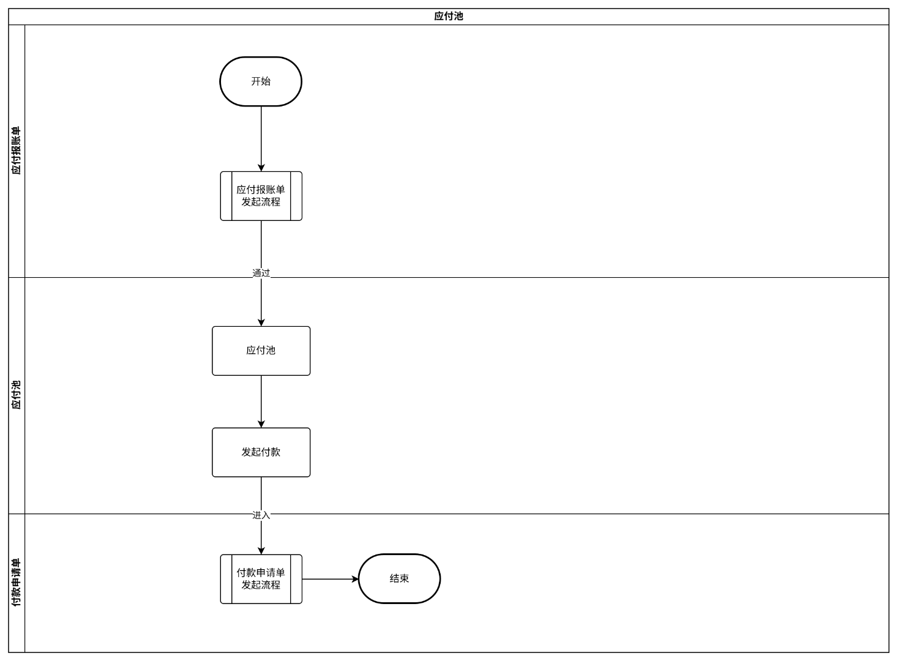
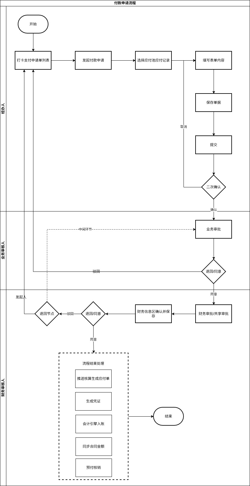

# 13 单据链路与业务规则：应付全链路、三单匹配、共享派单

> **什么时候用得上**：联调对不上状态、被问“这张付款单为什么卡在付款中”、要配三单匹配容差、共享中心派单规则不生效。<br>
> **一句话结论**：真实链路比“报账单 → 付款申请 → 付款 → 核销”**多两跳**（应付池、支付申请池/资金结算单/支付记账单），且核销是**应付核算侧的一张独立单据**；三单匹配**不是一个可配置的匹配引擎**，能力分散在三处；共享派单是**“先自动派单、再人工保底”**的双层结构。

## 1 应付真实链路：比你记的链路多两跳

```
应付报账单 →（审批通过）应付池 →（发起付款）付款申请单 →（审批通过）支付申请
→ 资金结算单 → 支付记账单 → 应付核销单
```

付款申请单审批通过后**并行**触发一条核算分支：推送核算生成应付单 → 生成凭证 → 会计引擎入账 → 同步合同金额 → 预付核销。


<small>图 13-1 报账单审批通过入池、池内发起付款进入付款申请单（来源 image id `f0X3LkcJimn8U7b5Awnpkg`）</small>


<small>图 13-2 业务审批 → 财务审批（可预览凭证）→ 流程结束处理（来源 image id `gf11lzvm-YCmQXyQsovDQw`）</small>

### 逐环要点

| 环节 | 关键点 |
|---|---|
| **报账单 → 应付池** | 池中记录带“可占用/已占用”；菜单里有「应付记录占用明细」，说明**应付记录表 + 占用明细表是一对多的成对结构**。从应付池发起付款时，流程里**多一个「复核会计确认」环节**（直接发起付款申请没有这一环）。 |
| **应付池 → 付款申请单** | 两个来源：从池里“选择应付记录”，或直接新增。主表带**五个子表**：申请明细（应付款记录编码）、预付明细（预付款记录编码）、支付调整明细、支付计划、支付明细。单据类型至少三种平行类型，各自独立编号（FKSQD… / YFSQ… / YJBZJFK…）。 |
| **付款申请单 → 支付申请池** | 资金结算单创建接口要求**双键必填**：`payApplyDocNo`（付款申请单编号）与**支付申请编码**是两个不同单据的编号 ⇒ **支付申请是独立一层，不能省**。`bizBillId`（支付指令唯一编码）必填；`paymentNetworkMode`（1-直连/0-非直连）。 |
| **资金结算单** | 六态：未付款 →（重复支付校验）→ 付款中 → 付款成功/付款失败；异常态「疑似重复」「部分成功」。内部编码 `pay_status`：10-待处理、20-处理中、30-疑似重复、40-支付成功、50-支付失败、60-部分成功。 |
| **支付记账单** | 两态：审批中、已完成。主键带三个子表：流水信息、票据信息、**核销关系**。 |
| **应付核销单** | 应付核算 → 核销单；支持**核销/对冲/调整**三种类型；走「发起 → 业务审批 → 财务审批」，最终生成核销单凭证。**核销不是报账侧的一个动作。** |

### 状态机汇总

| 单据 | 状态机 |
|---|---|
| 应付报账单 | 发起流程 → 通过 → 入池（⚠️ 报账单本站的完整状态定义未取到） |
| 付款申请单（单据状态） | 草稿 → 审批中 → 已完成；旁路：作废、冲销（未冲销 → 已冲销） |
| 付款申请单（**入账状态**） | 未入账 → 关联应付单/凭证 → **全部金额 = 已入账；部分金额 = 部分入账** |
| 支付申请池 | **两套状态并行**：推送状态（未推送/已推送）；支付状态（整单驳回/未支付/付款成功） |
| 资金结算单 | 未付款 → 付款中 → 付款成功/失败；异常：疑似重复、部分成功；旁路：付款终止、付款取消 |
| 支付记账单 | 审批中 → 已完成 |
| 应付单（核算侧） | 草稿/未验证/未入账 → 已验证 → 审批中 → 已完成 → 入账中 → 已入账｜入账失败（可重新入账）；旁路：已冲销/已驳回/已作废 |
| 应付核销单 | 草稿 → 发起 → 业务审批 → 财务审批 → 完成；旁路：冲销、作废、驳回 |

> **入账状态是按金额比例判定的，不是按事件**：关联应付单和凭证后，入账金额为“全部金额”才置“已入账”，部分金额置“部分入账”。

## 2 五个异步点（联调最容易踩）

1. **支付状态回写（INT-014）**：接口 `fin_fus_payment_result`，应付/资金支付完成后通过消息回写。入参 `payApplyDocNo`、`payStatus` 必填，**`payAmt` 非必填** ⇒ **“实付金额”必须另有取数路径（银行流水），不能假设回写报文带金额。**
2. **推送司库后的“付款中” + 主动轮询**：不返回结果就一直停在付款中，需要调“付款查询”才推进。
3. **推送状态与支付状态分别更新**：推送成功只把推送状态置“已推送”，支付状态仍是“未支付”。
4. **审批通过后的“流程结束处理”链路**：推核算→生成凭证→引擎入账→同步合同金额→预付核销。**任一步失败 = 单据显示已完成但核算没跟上**，对应结账时的“期间存在未入账或入账失败的单据”。
5. **部分成功后分叉**：司库返回“部分成功”时，失败部分生成**重新支付申请单**再走一轮——这是唯一会“长出新单据”的异步分支。

另有两个**人工确认**场景：线下支付成功/失败的「标记成功 / 标记失败（需填原因）」。

## 3 核销：行对行的余额匹配

- 核销明细表是一组**配对结构**：目标核销单行ID / 目标币种 / 源核销单行ID / 源币种 / 本次核销金额 / 本次目标本币核销金额 / 本次来源本币核销金额 / **核销汇差**。
- 算法是**循环匹配 + 余额耗尽即停**：一笔应付可对多笔预付，反之亦然，核不完的余额留在原行。
- 接口用**正负号 + 两组行**表达方向：`applyType` + `applLines`（应付侧，`sourceDocType=STANDARD_PAYABLE`）+ `creditLines`（贷项侧，`sourceDocType=CREDIT`），带 `crossCurrencyFlag`。`availApplAmount`（可核销余额上限）与 `applicationAmount`（本次核销金额）**是两个不同字段，别混**。
- **撤销核销的定位键**：「单据类型 + 应付单ID + 应付单来源行ID」→ 取付款计划ID。**这就是“单据类型必须成对配置”的深层原因——它不只是标签，还是回写与撤销的主键之一。**
- 核销关系有**三个落点**，职责不同：支付记账单的核销关系子表（支付动作）、付款申请流程结束处理的预付核销（自动）、应付核销单（正式单据 + 生成凭证）。
- 验收点：付款单明细支持「**联查报账单**」（仅“来源为应付报账”的付款单支持）。

## 4 三单匹配：不是一个可配置的匹配引擎

平台内**没有统一的“三单匹配规则配置”页面**，能力分散在四处：

| 环节 | 位置 | 形态 |
|---|---|---|
| 采购订单/入库单数据来源 | **外部采购/供应链系统，接口带入** | 不在本平台配置 |
| 发票与订单价格差异**校验** | 应付核算 → 应付报账单 → 结算明细 → **发票价格差异** | 按会计主体调容差配置 |
| **容差值**本身 | 应付核算 → **应付系统选项** | 4 个字段 |
| 差异**记账与分摊** | 成本管理（IPV、IRV → 分摊 → 分摊凭证） | 分摊策略配置 |

### 容差怎么配：应付系统选项的四个字段（按会计主体/法人实体）

| 序号 | 字段 | 必填 | 说明 |
|---|---|---|---|
| 8 | 不含税调整差异科目 | 否 | 必须选**末级成本/损益类且已启用**的科目 |
| 9 | **是否启用税允差控制** | **是** | 是/否 |
| 10 | **允差** | 否 | 数值（20,6），保留 2 位小数、**非负** |
| 11 | 不含税金额调整 | 否 | 数值，保留 2 位小数、非负 |

字段校验实测口径：`1.234` → 存为 `1.23`；`0` → 存为 `0.00`；`-1.23` → **保存失败，提示“需为非负数值”**；非数字不允许输入。

### ⚠️ 同一个“允差”字段有两套互相冲突的定义（实施前必须定口径）

| 口径来源 | “允差”的定义 |
|---|---|
| 配置手册、用户手册 | 采购发票与采购订单**价格差异**的允许上限金额 |
| 产品说明书、BRD、数据资产目录 | 应付单**含税时税可修改的绝对值上限**；税允差未启用时非必填且**不允许编辑**；按法人实体控制 |

BRD 给出的税允差算法：**允差计算值 = 应付单行不含税金额 × 税率 − 当前修改后的税额**，启用时按绝对值控制，**修改前后之差的绝对值 ≤ 配置值**（例：允差 0.5 ⇒ 允许区间 −0.5 ~ +0.5）。

### 匹配粒度是“行”级

应付单发票行上并排存在：`matchPoFlag`（是否匹配采购订单）、`poNum`、`poRcvNum`/`poRcvLineNum`（入库单号/行号）、`quantity` 与 `invoiceQuantity`、`unitPrice`、`ipvAmount`/`baseIpvAmount`、`settlementAmount`/`accrualAmount`、`baseVarianceAmount`、`varianceTypeLkc`。

容差校验不只看单张发票差额，而是按**合同累计口径**：输入输出包括合同总金额、预付总金额、到票金额、**在途到票金额 / 在途付款金额 / 在途预付金额**、已付金额、已预付金额。建议服务提供方为「发票管理」。

> ❌ **部分匹配、多次匹配：知识库没有取到明确开关或配置项。** 只能确认数据结构留了口子（发票行上同时有 `quantity` 与 `invoiceQuantity`、`poRcvLineNum`），**不足以证明功能已实现**。要确认得找应付核算产品。

## 5 共享运营：任务池是“先自动、再人工”

### 结构

- 任务池六个页签：**待分配、办理中、退回、挂起、已办、全部**。
- 三级视图：任务池（待分配/已办）、个人任务（待办/已办/退回/挂起）、组长管理（工作组待分配/办理中/已完结/退回/挂起）。
- 待分配页三个默认行为：进入即加载**全共享中心**待分配任务（未分配原因默认“全部”）；**未分配原因不为空的单据自动置顶**；自动刷新默认开启、**间隔 20 秒**。

### 自动派单的九步判定链（失败原因可直接当运维排查清单）

1. 任务模式为派单/组合 → **定时任务** → 派单规则任务器
2. 按状态、进入共享时间排序，**加急单据优先**
3. **是否在派单时间内** → 否则入待分配池，原因“未在派单时间内”
4. **是否指定派单** → 指定人员 / 指定标签
5. 找岗位下员工
6. **是否开启排己** → 排除与制单人一致的员工
7. **员工是否在岗** → 否则“未查询到在岗员工”
8. **是否加急 / 是否达到派单阈值** → 达到则“员工当日分配任务已满”
9. 按**熟练度规则** → 按**负载** → 分配至员工待办

四个自动派单失败原因：**未在派单时间内、未查询到符合条件的员工、未查询到在岗员工、员工当日分配任务已满**。分配日志记录触发时间、规则编码、岗位、人员和任务状态。

### 人工保底

分配（选工作组/岗位/人员）、组长**取回**（回到组长待分配、处理人置空）、组长**转派**（支持多选批量）。

### 派单规则的可配置项（一主三从结构）

`任务分配规则`（`fin_foc_task_assign_rule`）+ `规则生效条件`（表达式）+ `指定派单规则/条件` + `派单设置 / 抢单设置`。

| 你关心的维度 | 系统实际字段 | 说明 |
|---|---|---|
| **组织** | 机构 `orgCode`、工作组 `groupCode`、岗位 `positionCode`、任务类型、单据类型、班次 `shiftCode` | 这些是规则的**绑定键**（唯一定位适用范围），不是偏好权重 |
| **能力** | 熟练度 `proficiency` | `0` 全部 / `1` 熟练度高优先 / `2` 熟练度低优先，**必填**；另有排己 `exclude_self` |
| **负载** | `dispatchLoad` | `0` 待办任务最少者优先 / `1` 当日分配任务最少者优先，**必填** |
| **优先级** | `priority` | **数值越小越先执行** |
| **金额** | 无内置字段 | 只能走「规则生效条件」表达式：`compare_field` + `compare_operator` + `compare_value` + `link_operator` + 括号 |

- **分配模式** `assign_mode`：`DISPATCH` 派单 / `GRAB` 抢单 / `COMBO` 组合。
- **派单阈值** `dispatchThreshold`：每日派单阈值，**0–10000，步长 1，必填**，达到即“员工当日分配任务已满”。
- **抢单侧常被漏配**：每日最多抢单次数、单次抢单最大数量、在手量阈值、抢单时间类型（`SPECIFIED`/`RANDOM`）、时间范围、是否排己。
- **不生效先查依赖前置**：共享中心机构 → 共享工作组 → 共享岗位 → 节点类型 → 流程同步 → 业务对象配置 → 班次管理 → 单据类型。
- **权限**：只有共享中心**系统管理员**能新增/更改/停用派单模式。
- **错误码**：任务分配配置类以 **`553006`** 开头。

> ⚠️ **同一个枚举在三处口径不一致**：详设接口层是数字（`proficiency` 0/1/2、`dispatchLoad` 0/1），物理表注释是英文（`SKILLED`、`HIGH/MEDIUM/LOW`），产品说明书下拉是四种中文枚举（当天任务分配最少者优先 / 待办任务最少者优先 / 当天岗位任务分配最少者优先 / 当天稽核任务分配最少者优先）。**前端取值映射必须以最终接口文档为准。**

### 退回与重派

- 退回是**独立任务状态**，不是审批流的附属动作。
- **关键规则：退回单据重新回到共享员工手中时，不检查阈值且不计入阈值。**（否则驳回重办会被人为卡住，UAT 必须专门验这一条）
- 退回原因可配置：`审核驳回事由维护` + `单据驳回事由对应岗位定义`（**驳回给谁是按岗位映射的**，不写死在流程里）。

### 质检与绩效

- 流程四步：维护质检项目 → 制定质量检查计划 → 执行质量检查并跟踪 → 出具质量检查报告。**只有共享中心质量管理部门**能维护质检项目/计划/抽样规则/执行/出报告。
- 抽样方式：**自动抽查**（系统数据为主，设定规则自动随机抽取，检查周期月/季/年）+ **指定抽查**。
- 度量字段：样本总数量（自动统计）、质量检查执行人、**抽检合格率（自动收集样本数与合格数计算）**、抽检结果（合格/不合格）；质检对象带初审员工/复核员工，硬规则是**初审岗与复核岗不能是同一人**。
- 绩效：**全自动采集**，指标按“岗位序列 + 管控维度”。员工级：处理量、平均处理时长（分钟）、任务超时率；部门级：总处理量、完成率、平均处理时长。绩效台账带指标权重比例与考核周期（月/季/年）。看板指标：手工凭证量、超期单据、平均处理时长、一次性通过率。
- 权限：管理员可维护指标，**员工只能查自己的**。

## 6 本篇的待确认项

1. **应付报账单本站的完整状态机**（只取到“发起 → 通过 → 入池”）。
2. **付款申请单字段级金额校验**（单笔/超付/超占用余额的拦截规则与报错文案）。
3. **核销金额上下限校验与报错码**。
4. **支付状态回写的重试/幂等机制**（只写“消息回写”）。
5. **三单匹配的部分匹配/多次匹配是否真的支持**。
6. **“允差”字段到底控制哪个对象**（价差 vs 税额修改上限）—— 两套官方口径冲突，必须定一个。
7. **质检抽样比例**的具体配置项与取值方式。
8. **退回后自动重派规则**（是否回原处理人、重派次数上限）。
9. **绩效取数的表级字段与时长口径**（是否扣非工作时间、超时阈值）。